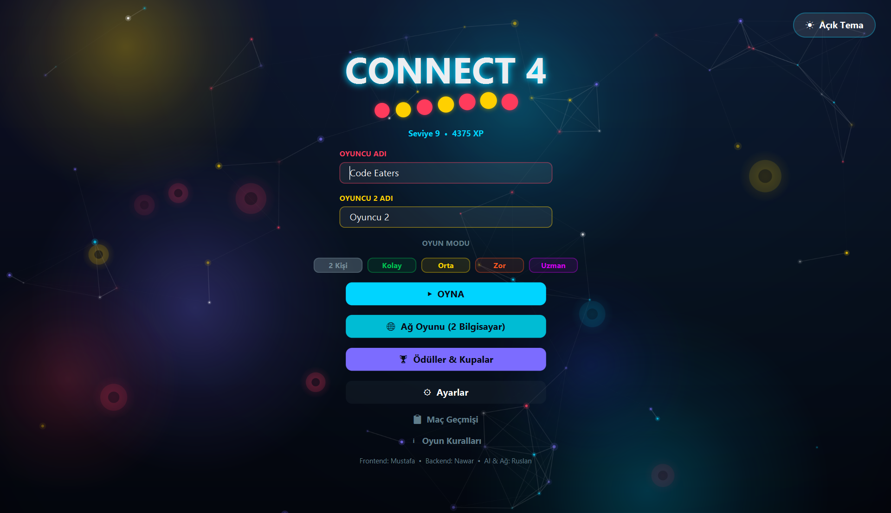
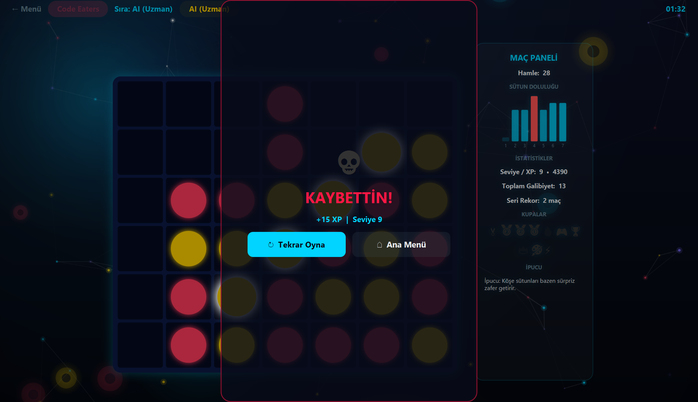

# Connect 4 — JavaFX

A desktop Connect 4 game written in Java 21 and JavaFX, built as an end-of-semester
university project (graded 100/100). You can play against a friend on the same
computer, against a minimax AI with four difficulty levels, or against another player
over the local network.

| Main menu | Game vs. AI |
|---|---|
|  |  |

## Features

- **Three game modes**: local 2-player, vs. AI, and LAN multiplayer (two computers)
- **AI opponent** with four levels
  - *Easy*: random moves
  - *Medium*: takes a winning move, blocks the opponent's winning move, prefers the center
  - *Hard / Expert*: minimax with alpha-beta pruning, 5 and 7 plies deep
- **Network play** over TCP with an authoritative host: every move is validated on
  the host and then broadcast, so both boards always stay in sync
- **Progression system**: XP, levels, win streaks and 10 unlockable achievements,
  saved between sessions
- **Match history** of the last 30 games
- **5 color themes** plus light and dark mode
- **Animations**: falling discs with a squash effect, a highlighted winning line,
  confetti and an animated particle background
- **Procedurally generated sound effects**: tones are synthesized as WAV data at
  startup, so the project ships no audio files

## Requirements

- JDK 21 or newer
- Maven 3.8+

JavaFX is downloaded automatically by Maven, so you don't need a separate JavaFX SDK.

## Running

```bash
mvn javafx:run
```

To run the tests:

```bash
mvn test
```

### Playing over the network

1. On the first computer, open **Ağ Oyunu → Oda Kur & Bekle**. The screen shows
   this computer's local IP address.
2. On the second computer, open **Ağ Oyunu**, enter that IP and click **Odaya Katıl**.
3. Both computers must be on the same network, and TCP port **5555** must be allowed
   through the host's firewall.

To try it on a single machine, start the game twice and join `127.0.0.1`.

## Project structure

```
src/main/java
├── core
│   ├── constants   Config: board size, colors, themes, global settings
│   ├── logic       GameLogic (rules engine, UI-independent) and Connect4AI
│   ├── model       PlayerProfile, Achievement, RewardManager (XP and achievements)
│   └── network     Host/Client peers, line-based text protocol, LAN IP discovery
├── ui              JavaFX screens (splash, menu, game, lobby, settings, ...)
└── util            SoundManager (tone synthesis) and UiHelper (shared UI factory)
src/test/java       JUnit 5 tests for the rules, the AI, the protocol and the profile
docs/screenshots    Screenshots used in this README
```

`GameLogic` has no JavaFX dependency. The same class runs local games, the
authoritative network state and the AI's search tree.

### Network protocol

The host and client exchange plain-text lines separated by `|`:

| Message | Direction | Meaning |
|---|---|---|
| `JOIN\|name` | client → host | Join request |
| `WELCOME\|player\|hostName\|clientName` | host → client | Accepted; assigns the player number |
| `MOVE\|col` | client → host | Proposed move |
| `RESULT\|col\|row\|player\|next\|gameOver\|winner\|cells` | host → client | Validated move |
| `RESET\|` | host → client | New match |
| `ERROR\|message` | host → client | Rejected move |
| `DISCONNECT\|` | both | Leaving the game |

### Saved data

The player profile is stored in `~/.connect4gui_profile.txt`. It holds XP,
statistics, achievements and match history. Delete this file to reset your progress.

## Team

| Role | Member |
|---|---|
| Frontend | Mustafa |
| Backend | Nawar |
| AI & Networking | Ruslan |

---

## Türkçe özet

Java 21 ve JavaFX ile yazılmış bir Connect 4 oyunu. Dönem sonu projesi olarak
geliştirildi ve 100 aldı. Aynı bilgisayarda iki kişi, dört zorluk seviyeli yapay
zekâya karşı (minimax + alfa-beta budama) veya yerel ağ üzerinden iki bilgisayar
arasında oynanabilir. XP ve seviye sistemi, başarımlar, maç geçmişi, 5 renk teması
ile açık ve koyu mod içerir.

Çalıştırmak için: `mvn javafx:run`. Testler için: `mvn test`.

## License

[MIT](LICENSE)
